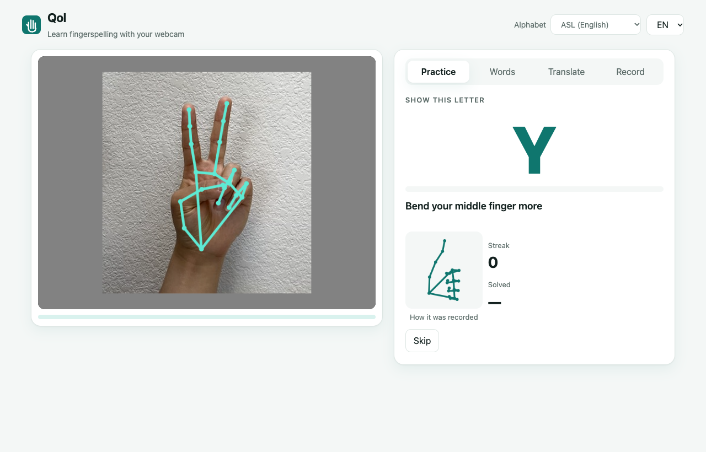
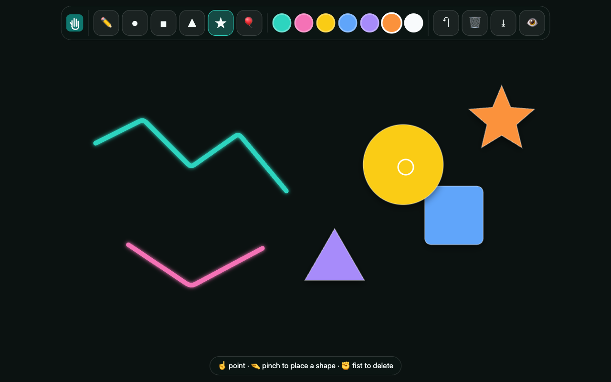

# Qol — fingerspelling coach in your browser

**Qol** (Kazakh for *hand*) teaches sign language fingerspelling with an ordinary webcam.
Show a letter, and Qol tells you which finger to fix: *"Bend your ring finger more"*,
*"Move your thumb to the left"*. It runs entirely in the browser: no account, no server,
and the video never leaves the device.

**Try it: https://044shad1k.github.io/qol/** (Chrome, Edge or Safari, allow the camera)



## Why

- Most fingerspelling apps cover only American Sign Language. Learners of smaller national
  sign languages, such as Kazakh–Russian fingerspelling with its extra letters
  Ә Ғ Қ Ң Ө Ұ Ү Һ І, have almost no interactive tools.
- A video tutorial shows the right shape but cannot tell a learner what is wrong with *their* hand.
  A human teacher can, but is not available every evening.
- Families and classmates of deaf children are the people who most need to learn quickly, and they
  usually learn at home.

## What is new

1. **Any alphabet, recorded by a teacher in minutes.** Qol does not ship a fixed model. A teacher
   or a fluent signer records each letter for a few seconds, and Qol learns it on the spot
   (few-shot nearest-neighbour recognition over hand landmarks). The recordings are exported as
   a small JSON *pack* that a whole class can import.
2. **Finger-level feedback.** Qol compares the learner's hand with the closest recorded example of
   the target letter, joint by joint, and turns the single biggest difference into one plain
   sentence.
3. **Private and offline.** Hand tracking (MediaPipe Hand Landmarker) and all logic run on the
   device. The model files are bundled, so after the first load it works without internet.

## Modes

| Mode | What it does |
|---|---|
| **Record** | Pick a letter, show it, press Record (or Space). 15 examples are captured in about 1.5 s. Export or import packs. |
| **Practice** | Shows a letter and a drawing of how it was recorded. Live match meter and one correction at a time. Hold the right shape for 0.6 s to pass. Letters you struggle with come up more often. |
| **Words** | Spell whole words letter by letter, or type your own. Shows your time per word. |
| **Translate** | Fingerspell to text: hold a letter to type it, lower your hand for a space, press Speak to read it aloud. |

The interface is in English and Russian. Alphabets included: Kazakh (42 letters), Russian (33),
ASL (26).

## Studio: build and play with your hand

**https://044shad1k.github.io/qol/studio.html**

The same hand tracking turns into a touch-free design tool. Your index finger is the cursor.

| Gesture | Action |
|---|---|
| ☝️ Point | Move the cursor. Hold it over a toolbar button for 0.7 s to press it. |
| 🤏 Pinch (thumb + index) | Draw a line, place a shape, or grab an existing shape. |
| 🔄 Twist your hand while holding | Rotate the shape. |
| ↕️ Move your hand closer or further while holding | Make the shape bigger or smaller. |
| ✊ Fist over a shape or line | Delete it (hold 0.6 s). |

Tools: freehand drawing, circle, square, triangle, star, 7 colours, undo, clear, save as PNG,
show or hide the camera. **Bubble game:** pop as many bubbles as you can with your fingertip in
45 seconds; your best score is saved.

Gestures are computed from the landmarks in `js/gestures.js`: pinch is the thumb–index distance
relative to palm length (with hysteresis so it does not flicker), rotation is the angle of the
knuckle line, and size is the palm's apparent length, which grows as the hand approaches the
camera. The cursor is smoothed more when the hand is still and less when it moves fast. A mouse
also works (drag to draw or move, scroll to resize).



## How it works

```
webcam ─► MediaPipe Hand Landmarker ─► 21 3-D landmarks
       ─► normalise: wrist at origin, scale by palm length, mirror left hands
       ─► pose = 60 coordinates + 5 finger bend angles
       ─► k-nearest neighbours over the recorded examples ─► letter or "unknown"
       ─► compare with the closest example of the target ─► one correction
```

- **Recognition** (`js/classifier.js`): weighted 5-nearest-neighbour vote. A pose that is far from
  every example is reported as unknown; the threshold is calibrated from how much the recorded
  examples of each letter vary.
- **Feedback**: first the finger whose total bend differs most from the reference (more than
  0.45 rad), then the fingertip that is furthest out of place, converted into a screen
  direction. If the shape matches but is read as another letter, Qol suggests checking the angle of
  the hand.
- **Storage** (`js/storage.js`): recordings and progress live in `localStorage`; packs are
  plain JSON.

## Run it

Camera access needs `https://` or `localhost`.

```bash
npm start          # serves the folder at http://localhost:8080
npm test           # unit tests (Node 20+)
```

Any static file server works; there is no build step.

## Tests

`npm test` runs the core tests on synthetic hands: invariance to position, size and handedness,
recognition of noisy new examples, rejection of unknown shapes, finger-level advice, pack
import/export, and the Studio gestures (pinch, fist, hand roll, size, mirrored cursor). The full interface was also checked in Chrome with a simulated camera, using
photos of real hands.

## Limitations and next steps

- **Static shapes only.** Letters that involve movement are recorded as their final hand shape.
  Next step: compare short landmark sequences with dynamic time warping.
- **Quality depends on the recordings.** Five or more recordings per letter from slightly different
  angles work best. Similar letters can be confused if the recordings are sloppy.
- **Not yet tested with deaf teachers.** The next step is to build an official Kazakh pack together
  with a deaf teacher and measure how fast learners improve.

## Credits

- Hand tracking: [MediaPipe Hand Landmarker](https://ai.google.dev/edge/mediapipe/solutions/vision/hand_landmarker)
  (Apache 2.0), bundled in `vendor/`.
- Code: MIT License.
